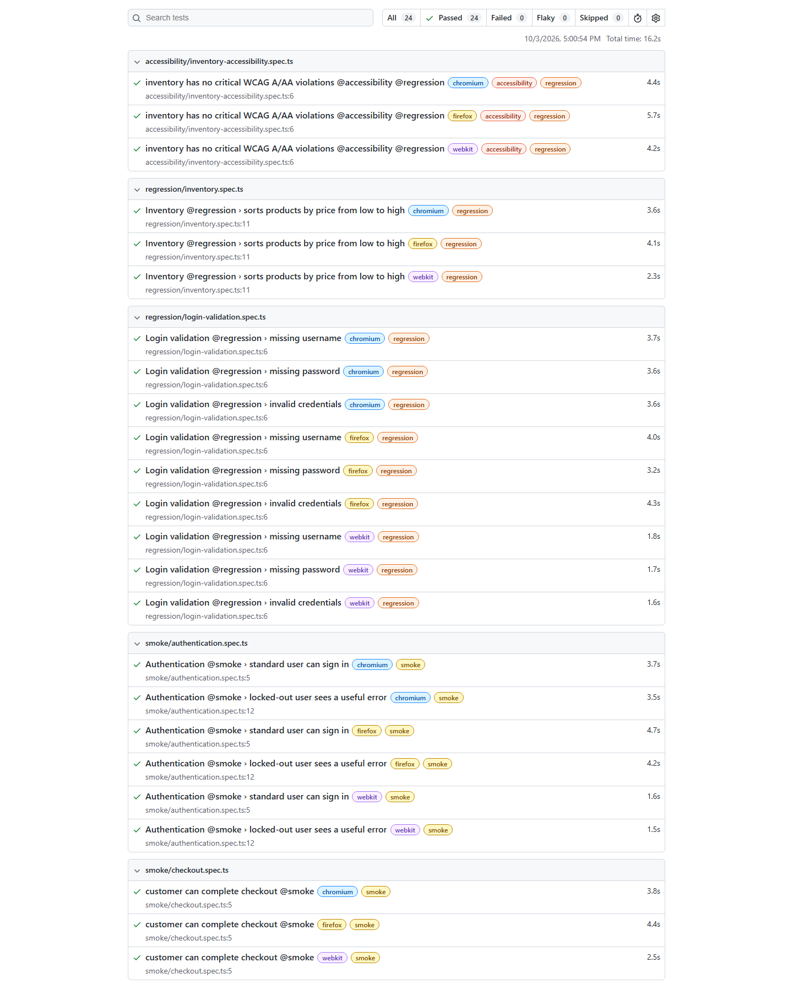
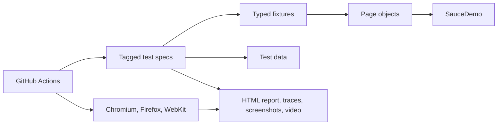

# Playwright E2E Test Framework

Cross-browser end-to-end automation for the public [SauceDemo](https://www.saucedemo.com/) storefront. This repository is a portfolio project focused on maintainable test design, useful failure evidence, and repeatable CI execution.

> Status badge and hosted report link are added when the repository is connected to GitHub.



## What this demonstrates

- Playwright with strict TypeScript and Chromium, Firefox, and WebKit coverage
- Page Object Model with fixtures and test data kept outside test logic
- Smoke and regression tags for targeted execution
- Data-driven negative authentication tests
- Automated axe-core scan for critical WCAG A/AA violations
- Screenshots, videos, and traces retained on failure
- Parallel browser jobs in GitHub Actions with a merged HTML report artifact
- Reproducible one-command execution in the official Playwright container
- Stable selectors and user-visible assertions instead of arbitrary waits

## Framework design



```text
pages/          page objects and UI actions
fixtures/       typed Playwright fixtures
test-data/      users, products, and checkout inputs
tests/smoke/    critical-path checks
tests/regression/ broader behavior and negative cases
.github/        cross-browser CI and report publishing
```

## Run locally

Prerequisites: Node.js 24 or another currently supported LTS release.

```bash
npm ci
npx playwright install --with-deps
npm test
```

Target a suite or debug interactively:

```bash
npm run test:smoke
npm run test:regression
npm run test:accessibility
npm run test:headed
npm run test:ui
npm run report
```

Set `BASE_URL` to point the suite at another compatible environment. See `.env.example`.

Run the same framework in Docker without installing browsers locally:

```bash
docker compose up --build --abort-on-container-exit
```

## CI and failure triage

Every push to `main` and every pull request runs the full suite in three browser engines. The workflow merges their blob reports and publishes one downloadable HTML report for 14 days. Failed jobs also retain Playwright traces, screenshots, and videos.

To inspect a trace downloaded from CI:

```bash
npx playwright show-trace path/to/trace.zip
```

## Test strategy

| Layer | Purpose | Current examples |
| --- | --- | --- |
| Smoke | Fast confidence in business-critical paths | Login, locked-user handling, completed checkout |
| Regression | Broader rules and edge cases | Price sorting, form validation, accessibility |
| Cross-browser | Detect engine-specific failures | Chromium, Firefox, WebKit on every CI run |

The target is a public demo application. No production system, personal data, or employer-owned test assets are used.

## Deliberate design choices

- Page objects expose business actions, while assertions stay close to test intent.
- Test data is explicit and deterministic so failures are reproducible.
- Retries are enabled only in CI; local failures stay visible during development.
- Evidence is captured on failure to keep successful runs lightweight.

## License

MIT
